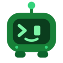

<p align="center">
  
</p>

<h1 align="center">gocode</h1>

<p align="center">
  <b>An agentic coding assistant for your terminal, written in Go.</b><br>
  Bring your own model. No account, no telemetry, one static binary.
</p>

<p align="center">
  <a href="https://github.com/umairge66/gocode/releases/latest"></a>
</p>

<p align="center">
  <a href="https://github.com/umairge66/gocode/releases/latest/download/gocode_linux_amd64.tar.gz"></a>
  <a href="https://github.com/umairge66/gocode/releases/latest/download/gocode_darwin_arm64.tar.gz"></a>
  <a href="https://github.com/umairge66/gocode/releases/latest/download/gocode_darwin_amd64.tar.gz"></a>
  <a href="https://github.com/umairge66/gocode/releases/latest/download/gocode_windows_amd64.zip"></a>
  <a href="https://github.com/umairge66/gocode/releases/latest"></a>
</p>

<p align="center">
  <a href="https://github.com/umairge66/gocode/actions/workflows/ci.yml"></a>
  <a href="https://github.com/umairge66/gocode/releases/latest"></a>
  <a href="LICENSE"></a>
  
  
</p>

<p align="center">
  <a href="#install">Install</a> ·
  <a href="#quick-start">Quick start</a> ·
  <a href="#features">Features</a> ·
  <a href="#chrome-browser-control">Chrome extension</a> ·
  <a href="https://github.com/umairge66/gocode/releases">Releases</a> ·
  <a href="https://github.com/umairge66/gocode/issues">Issues</a>
</p>

---

gocode is a coding agent that lives in your terminal. You describe what you want; the model reads and searches your code, edits files, runs commands, checks its work and reports back, asking before anything risky. Meet **Prompty**, the little terminal on the start screen who keeps you company.

```
 ▄████████████▄   gocode v1.0.0
 ███▀█████▀▀███   openrouter · your-model · auto mode
 ███▀▀█████████   ~/projects/shop
 █████▀▀▀▀█████   Ready when you are.
```

## Why gocode

- **Your model, your key.** Works with 22 providers: OpenRouter, Anthropic, OpenAI, Gemini, xAI, Groq, Bedrock, Vertex, Azure and more. gocode talks to the provider directly; there is no gocode server in between.
- **Private by design.** No telemetry, no accounts, no data collection. Keys stay in your config directory (owner-only permissions) and never reach child processes.
- **Safe by default.** Every risky action asks first; shell commands can run in an OS sandbox (bubblewrap on Linux, Seatbelt on macOS) with the network off, and you can rewind code and conversation to any earlier point.
- **Cheap to run.** Prompt caching, on-demand tool loading, output limits and a loop guard keep token use low; costs are tracked per provider with real prices.
- **One binary.** A single Go executable with the search engine and the Chrome extension built in. No Node, no Python, no runtime to install.

## Install

**macOS, Linux, BSD:**

```sh
curl -fsSL https://raw.githubusercontent.com/umairge66/gocode/main/install.sh | sh
```

**Windows (PowerShell):**

```powershell
irm https://raw.githubusercontent.com/umairge66/gocode/main/install.ps1 | iex
```

The installer picks the build for your system, checks it against the release's `checksums.txt` and puts `gocode` in `~/.local/bin` (on Windows, `%LOCALAPPDATA%\Programs\gocode`, added to your PATH). Set `GOCODE_VERSION=0.1.1` for a specific release or `GOCODE_INSTALL_DIR` for another folder. After that, `gocode update` keeps it current.

**Or download the latest release** (these links always point at the newest version):

| Platform | Download |
|---|---|
| Linux | [x86_64](https://github.com/umairge66/gocode/releases/latest/download/gocode_linux_amd64.tar.gz) · [arm64](https://github.com/umairge66/gocode/releases/latest/download/gocode_linux_arm64.tar.gz) · [armv7](https://github.com/umairge66/gocode/releases/latest/download/gocode_linux_arm.tar.gz) · [386](https://github.com/umairge66/gocode/releases/latest/download/gocode_linux_386.tar.gz) |
| macOS | [Apple silicon](https://github.com/umairge66/gocode/releases/latest/download/gocode_darwin_arm64.tar.gz) · [Intel](https://github.com/umairge66/gocode/releases/latest/download/gocode_darwin_amd64.tar.gz) |
| Windows | [x64](https://github.com/umairge66/gocode/releases/latest/download/gocode_windows_amd64.zip) · [arm64](https://github.com/umairge66/gocode/releases/latest/download/gocode_windows_arm64.zip) · [x86](https://github.com/umairge66/gocode/releases/latest/download/gocode_windows_386.zip) |
| BSD | [FreeBSD x86_64](https://github.com/umairge66/gocode/releases/latest/download/gocode_freebsd_amd64.tar.gz) · [FreeBSD arm64](https://github.com/umairge66/gocode/releases/latest/download/gocode_freebsd_arm64.tar.gz) · [OpenBSD](https://github.com/umairge66/gocode/releases/latest/download/gocode_openbsd_amd64.tar.gz) · [NetBSD](https://github.com/umairge66/gocode/releases/latest/download/gocode_netbsd_amd64.tar.gz) |

AppImage, `.deb` and `.rpm` packages, the other Linux architectures, the Chrome extension and the signed `checksums.txt` are on the [Releases page](https://github.com/umairge66/gocode/releases/latest). Below, `<version>` is the release version without the `v` (e.g. `0.1.1`).

**With Go installed**, the quickest way is:

```sh
go install github.com/umairge66/gocode/cmd/gocode@latest
```

| Platform | File names |
|---|---|
| Linux | `gocode-<version>-linux-<arch>.tar.gz` (`amd64`, `arm64`, `386`, `armv7`, `riscv64`, `ppc64le`, `s390x`), an AppImage, or a `.deb` / `.rpm` package |
| macOS | `gocode-<version>-darwin-amd64.tar.gz` (Intel) or `-darwin-arm64.tar.gz` (Apple silicon) |
| Windows | `gocode-<version>-windows-amd64.zip`, `-arm64.zip` or `-386.zip` |
| FreeBSD, OpenBSD, NetBSD | `gocode-<version>-<os>-<arch>.tar.gz` |

**Archive** (any platform): unpack it and put `gocode` (`gocode.exe` on Windows) somewhere on your `PATH`:

```sh
curl -LO https://github.com/umairge66/gocode/releases/download/v<version>/gocode-<version>-linux-amd64.tar.gz
tar -xzf gocode-<version>-linux-amd64.tar.gz
install -m 0755 gocode-<version>-linux-amd64/gocode ~/.local/bin/gocode
```

The macOS and Windows builds are not code-signed yet: on macOS, if Gatekeeper blocks the binary, run `xattr -d com.apple.quarantine gocode` once; on Windows, SmartScreen may ask you to confirm the first start.

**AppImage** (Linux `x86_64` / `aarch64`): download, make it executable, run it.

```sh
chmod +x gocode-<version>-x86_64.AppImage
./gocode-<version>-x86_64.AppImage
```

**Debian / Ubuntu** and **Fedora / RHEL / openSUSE** (`amd64` / `arm64`):

```sh
sudo apt install ./gocode_<version>_amd64.deb
sudo dnf install ./gocode-<version>-1.x86_64.rpm
```

**Verify** a download against the release's `checksums.txt`: `sha256sum --ignore-missing -c checksums.txt`. A signed release also has `checksums.txt.sig` (minisign format); `gocode update` checks that signature before it installs a new version and refuses releases without one.

**From source** (Go 1.26 or newer):

```sh
git clone https://github.com/umairge66/gocode.git
cd gocode
go build -o gocode ./cmd/gocode
```

Cross-compile with `GOOS`/`GOARCH` as usual, e.g. `GOOS=windows GOARCH=amd64 go build -o gocode.exe ./cmd/gocode`. A source build reports version `dev` and does not update itself; [RELEASING.md](RELEASING.md) describes release builds.

## Quick start

**1. Install** gocode as described above, so that `gocode` is on your `PATH`.

**2. Add a key** for the provider you want, either with an environment variable

```sh
export OPENROUTER_API_KEY=sk-or-...
```

or inside gocode with `/login`, which stores it in `~/.config/gocode/auth.json`.

**3. Start coding:**

```sh
cd your-project
gocode
```

Pick a model with `/model`, then just say what you need: *"add pagination to the users endpoint and write tests for it"*.

## Features

### A real coding agent
Reads, searches and edits files, runs builds and tests, and verifies its own changes. It plans larger tasks with a to-do list, delegates research to **subagents**, and can orchestrate multi-step **workflows**.

### You stay in control
| Mode | What it does |
|---|---|
| **Auto** (default) | Routine actions run; risky ones are checked first |
| **Manual** | Asks before edits and commands |
| **Accept edits** | File edits go through, commands still ask |
| **Plan** | Read-only research, then a plan for you to approve: *"Ready to code?"* |

Cycle modes with **Shift+Tab**. Say "No" to any prompt and the turn stops; type feedback instead and the model adjusts. **`/rewind`** restores code and conversation to any earlier message.

### Built for the terminal
- **`@` file mentions** with fuzzy search (`@usrctl` finds `user_controller.go`) that respects every `.gitignore`.
- **`!` shell mode** runs a command directly, no model call needed.
- **Background jobs** for long builds and servers; the model is notified when they finish (`/tasks` lists them).
- Themes that match the mascot, a command palette (**Ctrl+P**), a sidebar (**Ctrl+T**) and a live context and cost view.

### Extensible
- **MCP** servers (`gocode mcp add …`), loaded on demand so many tools cost no context until used.
- **Skills, plugins, hooks and custom commands**, compatible with Claude Code's skill and plugin formats, so existing marketplaces work.
- **Language servers (LSP):** go-to-definition, references, hover and new errors after each edit, from `gopls`, `pyright`, `typescript-language-server` and others configured by a plugin.

### Chrome browser control
gocode can work in **your own Chrome** (or Chromium, Edge, Brave): open pages, read them, click, type, fill in forms and take screenshots. Ask things like *"open localhost:3000, sign up with a test account and tell me what breaks"* or *"check the pricing page and summarise the plans"*.

**What the model can do in the browser**

| Tool | |
|---|---|
| `navigate`, `tabs_create`, `tabs_close`, `tabs_context` | open pages and manage gocode's tabs |
| `read_page`, `get_page_text`, `find` | read a page's structure or text, find elements by description |
| `computer`, `form_input` | click, type, scroll, press keys, fill in form fields |
| `screenshot` | see the page as it looks |
| `browser_batch` | several steps in one go |

**Private and contained by design**
- **Local only.** The extension talks to the gocode process on your machine through Chrome's native messaging. No server, no account, no telemetry, no network calls of its own, and no port is opened.
- **Its own tab group.** Every tab gocode opens goes into a green **"gocode"** tab group, one per session. gocode can only see and control tabs in its group; your other tabs are off limits.
- **Cleans up after itself.** When a session ends, gocode closes its tab group. Tabs you dragged into the group yourself, and pages you asked it to keep open, stay.
- **Your permission rules apply**, the same as for every other tool.

**Set it up** (the extension is built into gocode, nothing else to download):

```sh
gocode chrome install
```

Then, once: open `chrome://extensions`, turn on **Developer mode**, click **Load unpacked**, choose the folder the command printed (`~/.config/gocode/chrome-extension`), and restart Chrome. The Prompty icon in the toolbar shows a red dot only when gocode can't be reached.

`gocode chrome status` checks the setup; after updating gocode, run `gocode chrome install` again and click **Reload** on the extension. Browser tools are offered in interactive sessions (use `--no-chrome` to turn them off) and in `-p` runs with `--chrome`. More in [`extension/README.md`](extension/README.md); a Chrome Web Store version is planned.

### Fast search
The model's `grep` runs a bundled **ugrep** that skips `.gitignore`d files, VCS folders and binaries, so searches on real projects return your code in milliseconds instead of a flood of `node_modules`.

### Scripts and CI
```sh
gocode -p "summarize the changes on this branch"
gocode -p "fix the failing test" --output-format json
gocode -p "…" --output-format stream-json --verbose
```

Headless runs (`-p`) print text, a JSON result or a JSON event stream, and save a transcript you can `--resume`.

## Providers

| | |
|---|---|
| **Gateways** | OpenRouter, Vercel AI Gateway, OpenCode Zen / Go, Hugging Face |
| **Model labs** | Anthropic, OpenAI, Google Gemini, xAI, Moonshot (Kimi), Z.ai, MiniMax, Alibaba Model Studio (SG / US) |
| **Fast inference** | Groq, Cerebras, Avian, Synthetic, io.net |
| **Cloud** | AWS Bedrock, Google Vertex AI, Azure OpenAI |

Run `gocode auth status` to see which keys gocode found and the variable each provider reads (e.g. `ANTHROPIC_API_KEY`, `XAI_API_KEY`, `GROQ_API_KEY`). Switch provider with `/provider` and model with `/model`.

## Commands

| Command | |
|---|---|
| `/model`, `/provider`, `/effort`, `/fallback` | choose the model, provider, reasoning effort and a fallback model |
| `/plan` | plan first, code after approval |
| `/rewind`, `/resume`, `/clear`, `/compact` | move through and manage conversations |
| `/context`, `/usage` (`/cost`), `/status` | see context size, spend and setup |
| `/config`, `/theme`, `/permissions`, `/memory`, `/hooks` | settings, look, permission rules, project memory |
| `/mcp`, `/plugin`, `/tasks`, `/export` | servers, plugins, background jobs, export a conversation |
| `/init` | write a `gocode.md` describing the project |
| `/help` | everything else |

On the command line: `gocode --help`, plus `gocode doctor`, `gocode mcp …`, `gocode plugin …`, `gocode sandbox …`, `gocode chrome …` and `gocode trust`.

## Configuration

| File | Purpose |
|---|---|
| `~/.config/gocode/settings.json` | your settings (`/config` edits it) |
| `~/.config/gocode/auth.json` | API keys (owner-only) |
| `.gocode/settings.json` | project settings, shared with your team |
| `.gocode/settings.local.json` | your project settings, not committed |
| `gocode.md` | project memory: instructions the model always sees |

A few useful settings:

```json
{
  "permissions": { "defaultMode": "auto", "allow": ["Bash(npm test:*)"] },
  "ui": { "theme": "prompty" },
  "fallbackModel": "openrouter/some-other-model",
  "loopGuard": { "warnAfter": 3, "stopAfter": 8 }
}
```

`GOCODE_CONFIG_DIR` moves the whole data directory; `gocode --settings file.json` (or inline JSON) adds settings for one run.

## Development

```sh
go build ./... && go vet ./...
go test ./...
```

GitHub Actions runs these on Linux, macOS and Windows for every push and pull request (`.github/workflows/ci.yml`). Releases are built by `.github/workflows/release.yml` from a version tag; [RELEASING.md](RELEASING.md) explains the process, and `scripts/build-release.sh <version>` produces the same archives locally.

Tests use temporary directories and an isolated home directory, and never call a real model.

| Path | |
|---|---|
| `cmd/gocode` | the CLI entry point |
| `internal/agent`, `internal/conversation` | the turn loop, compaction, loop guard |
| `internal/provider` | providers, model catalogs and pricing |
| `internal/tools`, `internal/toolrun`, `internal/toolreg` | built-in tools and the permission-checked dispatcher |
| `internal/ui` | the terminal UI (Bubble Tea) and Prompty |
| `internal/sandbox`, `internal/pathguard`, `internal/envsec` | sandboxing and path, network and secret guards |
| `internal/mcp*`, `internal/plugins`, `internal/skills`, `internal/lsp` | extensibility |
| `internal/chromehost`, `extension/` | the Chrome native-messaging host and extension |

## License

gocode is released under the [MIT License](LICENSE).

It bundles [ugrep](https://github.com/Genivia/ugrep) (BSD-3-Clause) and uses [fzf](https://github.com/junegunn/fzf)'s matching algorithm (MIT) and the [Charm](https://charm.land) libraries (MIT); see [`THIRD_PARTY_NOTICES`](THIRD_PARTY_NOTICES) for all third-party licenses (regenerate the Go module list with `python3 scripts/gen-notices.py` after changing dependencies).
